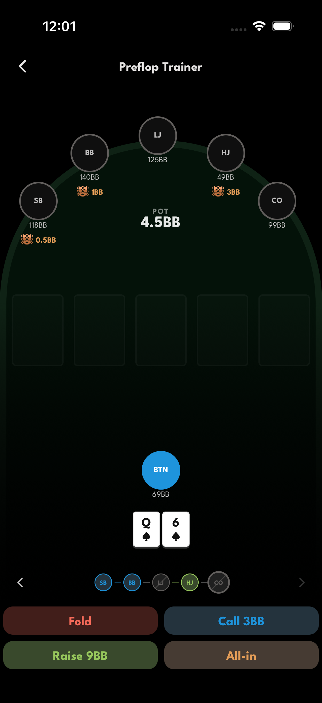
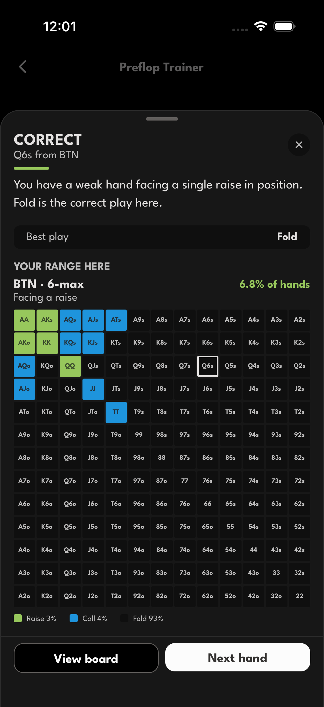
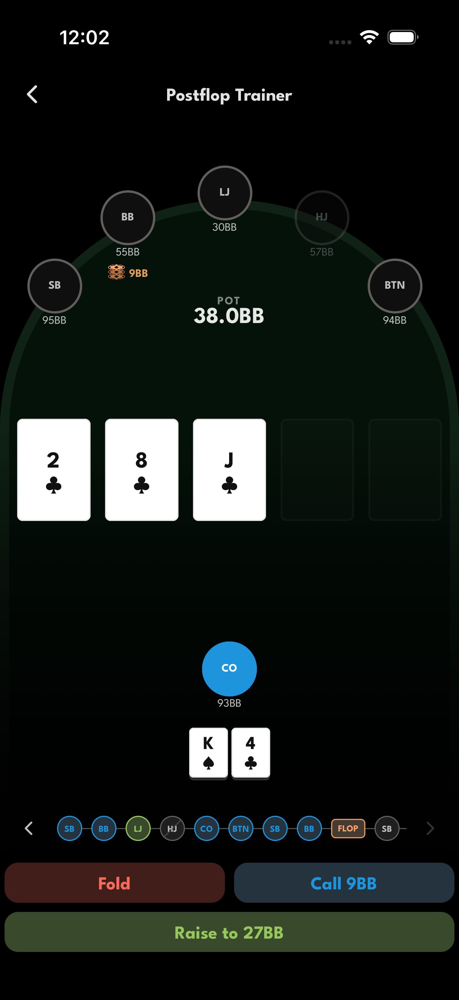
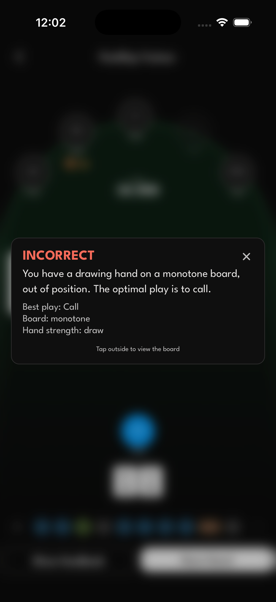

# Poker Trainer

https://github.com/user-attachments/assets/cf279781-7bb4-4587-84ba-d1e4b1d296b0

https://github.com/user-attachments/assets/b0fd4da8-4d52-4e25-8c89-6e9890f3ae7f

## Demo

Both trainers deal a fresh spot, take your action, and grade it instantly against the preflop charts and postflop heuristics in `packages/poker-engine`.

### Preflop trainer

| Decision | Feedback |
| --- | --- |
|  |  |

Every hand shows the table, stacks and action timeline. After you act you get the verdict, the best play, and the full 13x13 range chart for that spot with your hand highlighted.

### Postflop trainer

| Decision | Feedback |
| --- | --- |
|  |  |

Flops are generated with real board textures. Feedback names the texture, your hand strength, and the optimal line.

## Prerequisites

- **[Bun](https://bun.sh)** — installs dependencies and runs repo scripts (`bun install`, `bun run dev`, …).
- **Docker** and **Docker Compose** (PostgreSQL in development).
- **Xcode** / **Android Studio** as needed for iOS/Android simulators (mobile).

## First-time setup

1. **Install JS dependencies:** `bun install`
2. **Run the API and DB** `bun run docker:dev`
3. **Spin up the mobile app** `bun run dev:ios` or `bun run dev:android`

**New migrations:**

```bash
uv run alembic revision --autogenerate -m "describe change"
uv run alembic upgrade head
```

## Production deployment

`docker-compose.yml` runs Postgres, the API, and the Expo web build of the mobile app. Both the API and web app bind to `127.0.0.1` and expect a reverse proxy in front, with the API served under `/api` on the same domain.

1. **Create the env file:** `cp .env.production.example .env` and fill in the secrets
2. **Build and start:** `docker compose up -d --build`
3. **Point the reverse proxy at it**, e.g. with Caddy:

```
poker-trainer.example.com {
	handle /api/* {
		reverse_proxy localhost:8000
	}
	handle {
		reverse_proxy localhost:3000
	}
}
```

Migrations run automatically when the API container starts.

## Project structure

Bun workspaces monorepo — `apps/*` and `packages/*`.

```
apps/
  api/       FastAPI + SQLAlchemy + Alembic, PostgreSQL. Routers mounted from app/routers/
  mobile/    Expo (React Native) + Expo Router — where the trainers live
  web/       Vite + React + React Router v7 (landing page)
packages/
  api-sdk/       TypeScript client generated from the OpenAPI spec (bun run codegen)
  poker-engine/  Shared, framework-free poker logic: deck, evaluator, ranges, scenarios
docs/
  screenshots/   Images used by this README
```

| Path | What it holds |
| --- | --- |
| `apps/api/app/models/` | SQLAlchemy models — the source of truth for the schema |
| `apps/api/app/schemas/` | Pydantic request/response schemas |
| `apps/api/app/routers/` | FastAPI routers (`auth`, `users`, `preflop`, `postflop`) |
| `apps/api/alembic/versions/` | Migrations |
| `apps/mobile/app/` | File-based routes: `(auth)`, `(tabs)`, `train/preflop`, `train/postflop` |
| `apps/mobile/components/` | `ui/` primitives and `features/` feature components |
| `apps/mobile/theme/` | `ThemeContext` — components take a `Theme` via the `t` prop |
| `apps/web/src/pages/` | Web pages, wired up in `src/routes.tsx` |
| `packages/poker-engine/src/` | Hand evaluation, range lookup and scenario generation |

Data flows one way: SQLAlchemy models to Alembic migrations to FastAPI routes to the OpenAPI spec, then `bun run codegen` regenerates `packages/api-sdk/src/generated/`, which both the web and mobile apps consume via `@poker-trainer/api-sdk`. Nothing under `src/generated/` is hand-edited.

## Local endpoints

Once `bun run docker:dev` is running:

| Service | URL | Purpose |
| ------- | --- | ------- |
| API docs (Swagger UI) | <http://localhost:8000/docs> | Interactive, auto-generated FastAPI docs — try requests directly in the browser |
| CloudBeaver | <http://localhost:8978> | Web-based Postgres browser/admin for the `db` container |

Ports come from `API_PORT` and `CB_SERVER_URL` in your `.env` — adjust the URLs above if you've changed those.

### OpenAPI → TypeScript client

```bash
bun run codegen
```

Generates a typesafe interface for the mobile app to send requests to the server.

## Code quality (Biome)

This project uses [Biome](https://biomejs.dev) for both formatting and linting — no separate ESLint or Prettier needed.

**Editor setup (recommended):** install the [Biome VS Code extension](https://marketplace.visualstudio.com/items?itemName=biomejs.biome) (or the JetBrains plugin) and enable format-on-save. Biome will be picked up automatically from `node_modules/.bin/biome` via the root [`biome.json`](biome.json).
